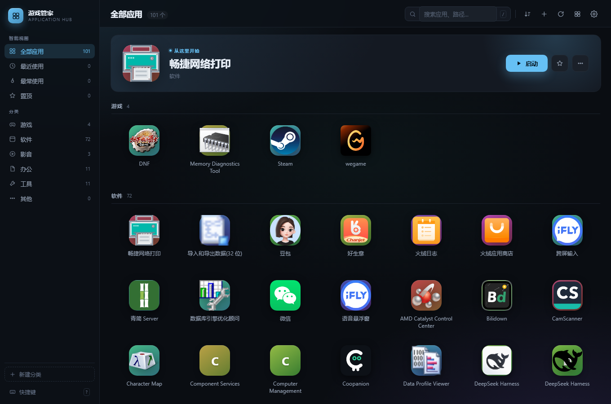
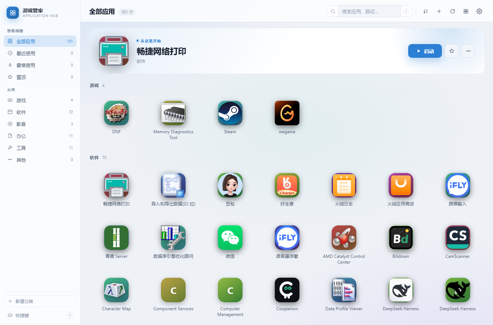
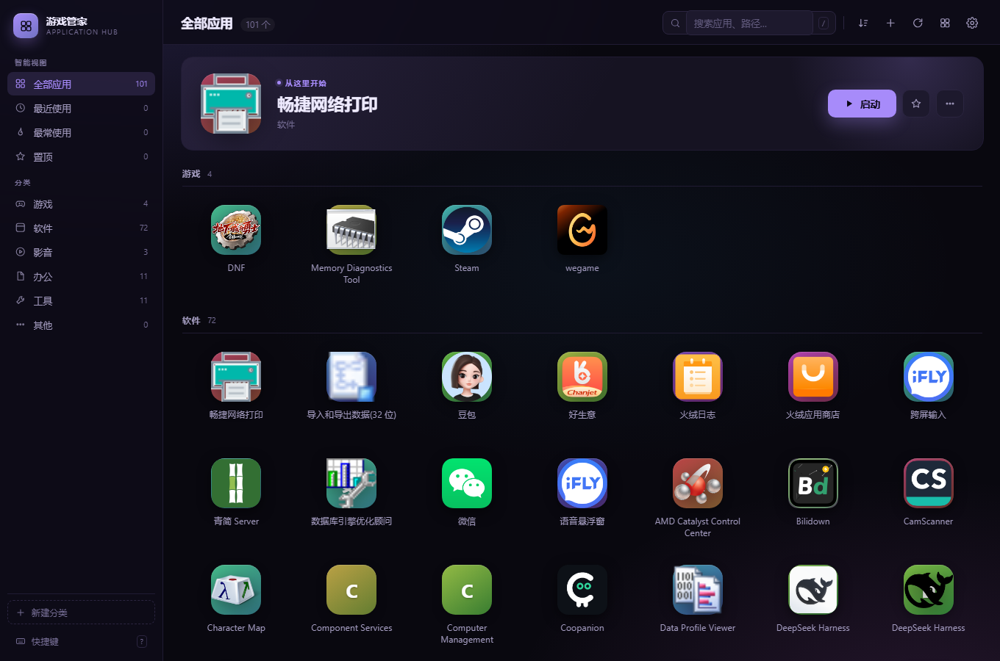

# 应用坞 · AppDock

一个放在本机的应用启动台（Dock），把常用的软件、游戏、工具收在一个界面里，双击图标就能打开。
纯本地运行，不联网、不上传任何数据。



## 怎么用

双击 **启动应用坞.vbs** 即可。

第一次打开会自动扫描本机，把开始菜单里能找到的软件和游戏列出来。
之后再装新软件，点右上角的「扫描」按钮补充，不会重复添加。

> 想看到运行日志、排查问题，用 `调试启动.bat`。

## 界面上能做什么

### 找应用

| 操作 | 方式 |
| --- | --- |
| 搜索 | `Ctrl+F` 或 `/`，支持多关键词（空格分隔），命中处高亮 |
| 智能视图 | 左侧「最近使用」「最常使用」「置顶」 |
| 按分类看 | 点左侧分类；或在分组标题上点「只看这类」 |
| 切换网格 / 列表 | `Ctrl+G` |
| 排序 | 右上角排序按钮：自定义 / 名称 / 最近 / 最常 |

### 操作应用

| 操作 | 方式 |
| --- | --- |
| 启动 | 双击（或 `Enter`，或右键 → 启动） |
| 以管理员身份运行 | 右键 → 以管理员身份运行 |
| 添加 | 右上角 `+`，或直接把 `.exe` 拖进窗口 |
| 编辑 / 改名 / 换分类 / 打标签 | 右键 → 编辑（`Ctrl+E`） |
| 换图标 | 编辑弹窗里点图标下方的相机按钮 |
| 置顶 | 右键 → 置顶，或鼠标悬停在顶部大图上点星标 |
| 调整顺序 | 直接拖动图标，卡片边缘会出现插入位置指示线，松手即保存 |
| 打开所在位置 / 复制路径 / 查看属性 | 右键菜单 |
| 移除 | 右键 → 从列表移除，或选中后按 `Delete` |

### 批量操作

`Ctrl+点击` 逐个加选、`Shift+点击` 连选、`Ctrl+A` 全选。
选中 2 个以上，底部会浮出操作条：**置顶 / 移到分类 / 移除**。

### 拖拽排序细则

- 拖到**另一个分类的图标上**：顺便移入那个分类
- 拖到**分组标题上**：移入该分类并排在末尾
- **多选后拖动**：整批一起移动，保持相对顺序
- 当前是「按名称/最近/常用」排序时，拖动会自动切回「自定义」排序（提示后重新拖即可）
- 搜索状态下不能拖动，先按 `Esc` 清空搜索

### 分类管理

左侧分类上右键，可以**重命名**或**删除**（删除时里面的应用会移到「其他」，不会丢）。

## 快捷键

| 键 | 作用 |
| --- | --- |
| `Ctrl+F` / `/` | 打开搜索 |
| `Enter` | 启动选中项 |
| `↑ ↓ ← →` | 移动选择 |
| `Ctrl+点击` / `Shift+点击` | 多选 / 连选 |
| `Ctrl+A` | 全选 |
| `Ctrl+E` | 编辑选中项 |
| `Delete` | 移除选中项 |
| `Ctrl+G` | 切换网格 / 列表 |
| `Ctrl+,` | 打开设置 |
| `?` | 快捷键说明 |
| `Esc` | 关闭弹窗 / 清空选择 |

## 外观

设置（`Ctrl+,`）里可调：

- **三套主题**：深灰蓝（默认）、午夜紫、浅色
- **强调色**：6 种预设，影响按钮、选中态、置顶角标
- **壁纸 + 遮罩 + 毛玻璃面板**
- **图标大小**、**紧凑模式**（一屏塞更多）、**按分类分组**

| 浅色主题 | 午夜紫主题 |
| --- | --- |
|  |  |

## 备份与迁移

设置 → 数据：

- **导出**：生成 `AppDock-备份-日期.json` 到数据目录并自动定位，拷走即可
- **导入**：选文件后可选「合并」（只补充新的）或「覆盖」（清空后还原）
- **重建图标缓存**：图标显示异常时点一下

## 双击没反应 / 弹错误框？

**1. 报「未结束的字符串常量」，错误码 800A0409**

`.vbs` 的编码被改坏了。Windows 脚本宿主只认 **UTF-16 LE** 或 **ANSI(GBK)**。

修复：记事本打开 → 另存为 → 编码选「Unicode」→ 保存。**千万不要存成 UTF-8。**

**2. 报「没有找到 Node.js」**

装一个 https://nodejs.org （18 以上），然后重新双击。

**3. 双击完全没反应**

看 `%APPDATA%\AppDock\log.txt` 最后几行，或者改用 `调试启动.bat`，报错会直接打在控制台里。

## 数据存在哪

配置和图标缓存都放在 `%APPDATA%\AppDock\`，不会写进程序目录：

> 从旧版「游戏管家 (GameKeeper)」升级上来的话，首次启动会自动把旧数据目录
> `%APPDATA%\GameKeeper\` 里的应用列表、图标、壁纸迁移过来，无需手动操作。

- `data.json` —— 你的应用列表、分类、设置
- `icons\` —— 从程序里抠出来的图标缓存，删掉会自动重建
- `wallpapers\`、`window-profile` —— 壁纸和窗口配置

想整体搬走或备份，复制这个目录即可。

## 它为什么这么轻

没有用 Electron。整体只有几百 KB 的脚本，界面用系统里已有的 Chromium 内核（Chrome / Edge）以无地址栏的独立窗口打开，
Python/Electron 那套上百 MB 的运行时一个都不需要，冷启动不到 1 秒。

图标不是截图也不是在线下载，而是直接解析 exe 的 PE 资源表（`RT_GROUP_ICON` / `RT_ICON`），
取出程序自带的 256×256 原图，所以高清、无网络依赖。

## 扫描范围

- 开始菜单（全局 + 当前用户）里的所有快捷方式
- Steam 游戏库（含多个库文件夹，走 `steam://rungameid/` 启动，兼容 DRM）
- Epic 游戏库

没有图标资源的系统工具（如 `.msc` 管理单元）会用名称首字母的色块代替。

## 环境要求

需要本机有 **Node.js 18+**。启动器会自动在 PATH 和常见安装目录里找 `node.exe`，
找不到会弹提示，装好后重新双击即可（https://nodejs.org）。

如果需要分发给没装 Node 的电脑，可以用 Node 自带的 SEA 打包成独立 exe：

```bash
node --experimental-sea-config sea-config.json   # 生成 sea-prep.blob
node -e "require('fs').copyFileSync(process.execPath,'AppDock.exe')"
npx postject AppDock.exe NODE_SEA_BLOB sea-prep.blob --sentinel-fuse NODE_SEA_FUSE_fce680ab2cc467b6e072b8b5df1996b2
```

## 已知边界

- 需要管理员权限才能启动的程序会自动弹 UAC 提权。
- 卸载类、帮助类、更新日志类的快捷方式在扫描时会被过滤掉。
- 一个程序在开始菜单里有多个入口时，按真实目标路径去重，只保留一个。
- 按「名称」排序时会自动取消分类分组，否则排序看起来不生效。

## 文件结构

```
AppDock/
├── 启动应用坞.vbs          # 双击入口
├── 调试启动.bat            # 带控制台输出的入口
├── main.js                 # 起本地服务 + 开无边框窗口
├── app.ico                 # 程序图标
├── lib/
│   ├── server.js           # 本地 HTTP 服务与接口
│   ├── store.js            # 数据读写（JSON 持久化）
│   ├── scan.js             # 开始菜单 / Steam / Epic 扫描
│   ├── pe-icon.js          # PE 资源表解析，提取 exe 图标
│   ├── launcher.js         # 启动进程、UAC 提权、剪贴板、属性
│   └── ps/                 # 两个 PowerShell 辅助脚本
└── public/                 # 界面（HTML / CSS / JS）
```
